# IGA Lab: Identity Governance untuk Active Directory

Portal **Identity Governance & Administration (IGA)** untuk Active Directory, mulai dari karyawan masuk sampai keluar:

- **Joiner–Mover–Leaver otomatis.** HR mencatat karyawan baru, pindah jabatan, atau keluar; akun dan akses AD mengikuti katalog jabatan tanpa tiket manual.
- **Permintaan akses dan jabatan sementara.** Setiap akses punya tanggal berakhir. Persetujuan berlapis (manager, lalu IT Security untuk akses privileged), dan dicabut otomatis saat masa berlaku habis.
- **Access review (certification).** Manager meninjau akses timnya secara berkala; akses yang dicabut langsung hilang dari AD, dan hasilnya bisa diunduh sebagai bukti audit.
- **Dashboard operasional.** Antrean tiket dengan status SLA, tren permintaan harian, waktu keputusan per tahap, akses yang paling sering diminta, aktivitas JML per minggu, alert keamanan, dan progres access review. Manager melihat timnya sendiri; HR dan IT Security melihat seluruh organisasi.
- **Pemantauan keamanan identitas.** Login mencurigakan dari audit log domain controller, akses yang diberikan di luar portal, dan perubahan group Tier-0 seperti Domain Admins.

Repo ini menyertakan lab lengkap: **domain controller Samba AD sungguhan**, organisasi fiktif ±70 karyawan yang dibuat lewat mesin JML yang sama, dan simulator aktivitas login. Semua nama, data, dan riwayat 90 hari terakhir adalah **simulasi untuk keperluan demo**.

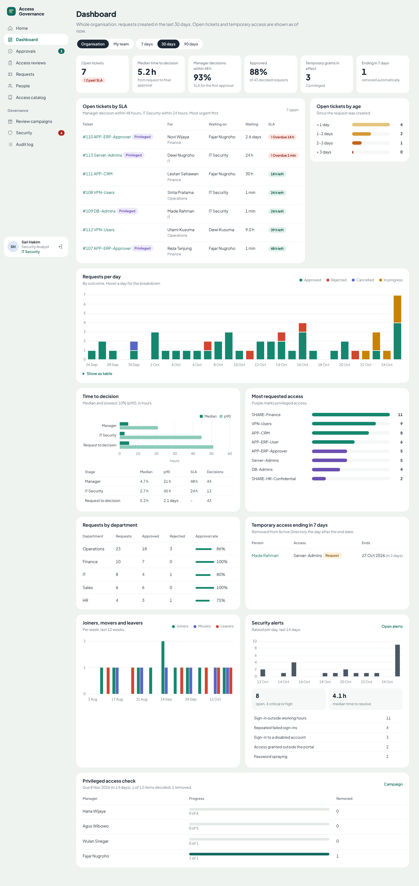

*Dashboard IT Security: tiket yang melewati SLA ditandai, waktu keputusan median dan p90 per tahap, serta tren 30 hari. Data 60 hari terakhir di lab adalah simulasi.*

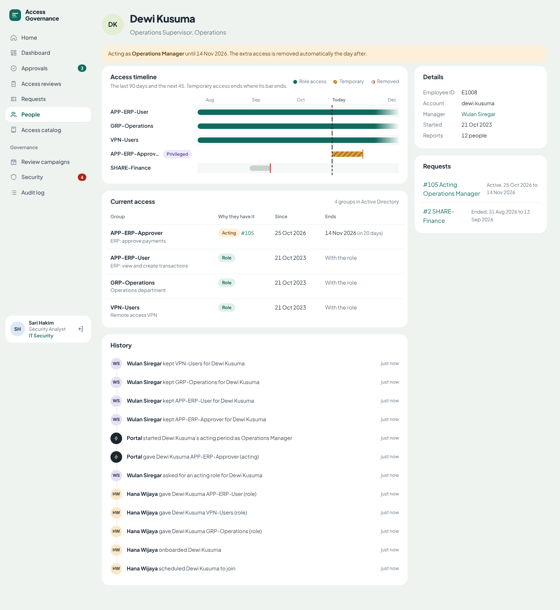

*Setiap akses punya awal dan akhir. Hijau: akses bawaan jabatan. Kuning bergaris: akses sementara yang berakhir tepat di ujung batangnya. Abu-abu: akses yang sudah dicabut.*

---

## Masalah yang diselesaikan

| Masalah umum di perusahaan | Yang dilakukan portal |
|---|---|
| Karyawan keluar, akunnya masih aktif berminggu-minggu | Leaver menonaktifkan akun, mencabut semua group, dan membatalkan permintaan yang tertunda dalam satu langkah |
| Pindah divisi, akses lama ikut terbawa (*privilege creep*) | Mover mencabut akses bawaan jabatan lama dan memberi akses jabatan baru |
| Akses "sementara" yang tidak pernah dicabut | Setiap permintaan wajib punya tanggal akhir; worker mencabutnya otomatis |
| Menggantikan atasan yang cuti tanpa jejak | Jabatan sementara (*acting*) memberi akses posisi tersebut dengan approval, lalu kembali normal otomatis |
| Admin menambahkan akses langsung di AD tanpa approval | Rekonsiliasi berkala mendeteksi akses di AD yang tidak tercatat di portal, lengkap dengan siapa yang mengubahnya |
| Audit menanyakan bukti review akses | Kampanye review per manager, dengan ekspor CSV keputusan dan komentar |

## Fitur per peran

| Peran | Bisa melakukan |
|---|---|
| **Karyawan** | Meminta akses atau jabatan sementara, melihat akses dan timeline sendiri, membatalkan permintaan |
| **Manager** | Menyetujui/menolak permintaan tim, meminta akses untuk anak buah, meninjau akses tim dalam kampanye |
| **HR** (`IGA-HR`) | Menambah karyawan baru, memproses pindah jabatan dan keluar, termasuk yang dijadwalkan ke depan |
| **IT Security** (`IGA-Security`) | Persetujuan kedua untuk akses privileged, memulai kampanye review, menindaklanjuti alert, membaca audit log |

Peran ditentukan dari group AD, dan group itu sendiri dikelola lewat katalog. Login memakai akun AD (LDAPS bind), tanpa database password terpisah.

## Arsitektur

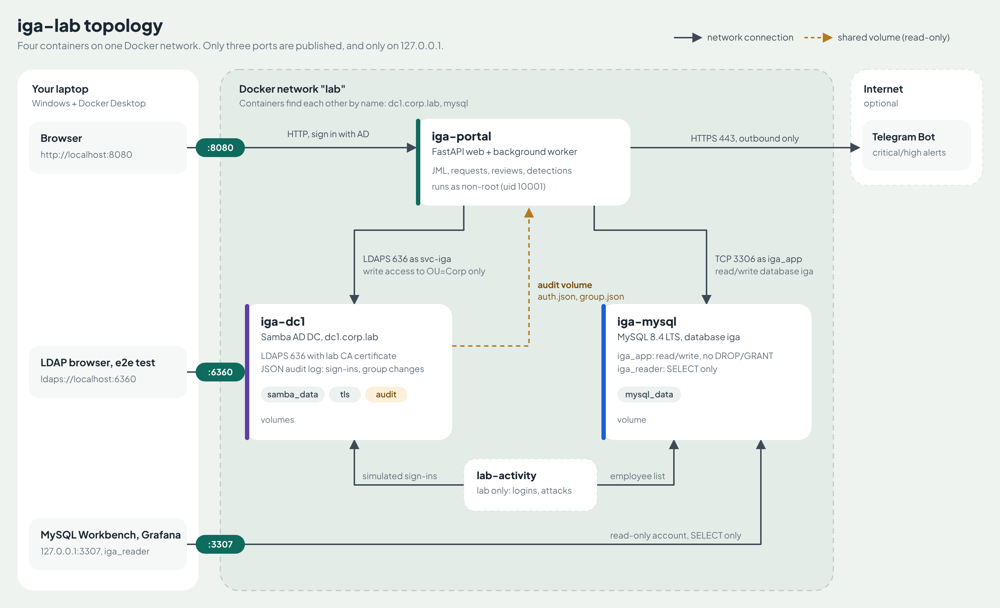

| Container | Isi | Terhubung ke |
|---|---|---|
| `iga-dc1` | Samba AD DC `dc1.corp.lab`, LDAPS dengan CA lab, audit log JSON (login & perubahan group) | — |
| `iga-portal` | FastAPI + worker latar belakang (30 detik): jadwal HR, aktivasi & kedaluwarsa akses, deteksi, rekonsiliasi AD vs portal, `/metrics` | dc1 lewat LDAPS sebagai `svc-iga`; MySQL sebagai `iga_app`; membaca volume `audit` (read-only) |
| `iga-mysql` | MySQL 8.4 LTS, database `iga`: karyawan, entitlement, permintaan, review, alert, audit log | — |
| `lab-activity` | Simulator login karyawan dan skenario serangan (khusus lab) | dc1 lewat LDAPS; MySQL sebagai `iga_reader` |

Hanya tiga port yang dibuka, dan hanya ke `127.0.0.1`: **8080** (portal), **6360** (LDAPS), **3307** (MySQL). Sumber diagram: [`docs/topology.svg`](docs/topology.svg).

### Model data inti

Setiap akses di AD yang dikelola portal adalah **entitlement** dengan sumber yang jelas:

| Sumber | Asal | Berakhir |
|---|---|---|
| `birthright` | Katalog jabatan, otomatis saat joiner/mover | Saat pindah jabatan atau keluar |
| `request` | Permintaan yang disetujui | Tanggal akhir permintaan |
| `acting` | Jabatan sementara | Tanggal akhir jabatan sementara |
| `exception` | Akses di luar portal yang disahkan IT Security | 30 hari |

Group di AD hanya dicabut jika tidak ada lagi entitlement aktif untuk group itu. Jadi akses yang dimiliki karena dua alasan tidak hilang saat salah satu alasannya berakhir.

## Dashboard dan SLA tiket

| Bagian | Isi |
|---|---|
| Angka utama | Tiket terbuka dan yang melewati SLA, median waktu keputusan, persentase keputusan manager dalam 48 jam, tingkat persetujuan, akses sementara aktif, akses yang berakhir 7 hari ke depan |
| Antrean SLA | Tiket terbuka diurutkan dari yang paling mendesak, dengan siapa yang ditunggu (manager tertentu atau IT Security) |
| Tren | Permintaan per hari per hasil (disetujui, ditolak, dibatalkan, masih diproses), dengan tampilan tabel untuk aksesibilitas |
| Kinerja approval | Median dan p90 waktu keputusan untuk tahap manager, IT Security, dan keseluruhan |
| Pola permintaan | Akses yang paling sering diminta (privileged ditandai) dan tingkat persetujuan per departemen |
| Siklus hidup | Joiner, mover, leaver per minggu (12 minggu), perubahan HR terjadwal, dan perubahan HR yang gagal |
| Keamanan & review | Alert per hari, median waktu penyelesaian alert, dan progres access review per manager |

SLA default: keputusan manager 48 jam, IT Security 24 jam (`SLA_HOURS` di `app/iga/dashboard.py`). Periode bisa diganti 7, 30, atau 90 hari. Warna grafik divalidasi aman untuk buta warna, dan Chart.js serta font Plus Jakarta Sans (buatan Tokotype, Jakarta) di-host sendiri sehingga portal tidak bergantung pada CDN.

## Database MySQL

Portal menyimpan datanya di MySQL 8.4 (`iga-mysql`). Ada dua akun aplikasi dengan hak minimum, dibuat oleh [`mysql/init/10-users.sh`](mysql/init/10-users.sh) saat volume pertama kali dibuat:

| Akun | Hak | Dipakai oleh |
|---|---|---|
| `iga_app` | `SELECT, INSERT, UPDATE, DELETE, CREATE, ALTER, INDEX, REFERENCES` di database `iga` saja | Portal |
| `iga_reader` | `SELECT` saja | MySQL Workbench, Grafana, auditor, simulator lab |

Tabel dibuat otomatis oleh portal saat start (InnoDB, utf8mb4, foreign key antar tabel, komentar di setiap tabel dan kolom penting). Waktu disimpan sebagai teks ISO-8601 lengkap dengan zona waktu, sama persis dengan yang tampil di audit log.

**Membuka di MySQL Workbench:** buat koneksi baru dengan Hostname `127.0.0.1`, Port `3307`, Username `iga_reader`, password = `MYSQL_READER_PASSWORD` di `.env`, Default Schema `iga`.

Contoh query:

```sql
-- Siapa saja yang punya akses privileged sementara, dan kapan berakhir
SELECT e.first_name, e.last_name, en.group_name, en.source, en.expires_at
FROM entitlements en JOIN employees e ON e.id = en.employee_id
WHERE en.revoked_at IS NULL AND en.expires_at IS NOT NULL
ORDER BY en.expires_at;

-- Tiket yang masih menunggu, dari yang paling lama
SELECT id, target, status, created_at FROM access_requests
WHERE status IN ('pending_manager', 'pending_security') ORDER BY created_at;

-- Alert terbuka per jenis
SELECT kind, severity, COUNT(*) n FROM alerts WHERE status = 'open' GROUP BY kind, severity ORDER BY n DESC;
```

Untuk Grafana, tambahkan data source MySQL ke `127.0.0.1:3307` (atau `iga-mysql:3306` jika Grafana berada di network Docker yang sama) dengan akun `iga_reader`.

## Keputusan desain dari sisi security

- **Akun layanan dengan hak tulis terbatas.** `svc-iga` hanya punya hak tulis di `OU=Corp` (didelegasikan dengan `samba-tool dsacl`). Portal bisa mengelola user dan group biasa, tetapi **secara teknis tidak bisa** mengubah Domain Admins atau mereset password Administrator. Ini sudah diuji: percobaannya ditolak dengan `insufficientAccessRights`.
- **Tier-0 di luar portal, tapi dipantau.** Domain Admins, Enterprise Admins, dan group Tier-0 lain sengaja tidak bisa diminta. Setiap perubahan anggotanya memicu alert critical, termasuk akun yang melakukan perubahan (dari audit log DC).
- **Pemisahan tugas.** Peminta dan penerima akses tidak bisa menyetujui permintaannya sendiri; akses privileged butuh dua persetujuan.
- **Batas durasi per akses.** Misalnya Server-Admins maksimal 7 hari, SHARE-HR-Confidential 14 hari.
- **LDAPS dengan verifikasi sertifikat penuh**, CSRF token di semua form, sesi bertanda tangan, cookie `SameSite`, dan container aplikasi berjalan sebagai user non-root.
- **Audit log untuk setiap perubahan**, termasuk login portal, keputusan approval, dan setiap grant/revoke ke AD.

## Deteksi keamanan

Sumbernya audit log JSON dari domain controller (`auth_json_audit` dan `dsdb_group_json_audit`), bukan log aplikasi, sehingga perubahan yang dilakukan lewat tool lain (ADUC, PowerShell) tetap terlihat.

| Alert | Kondisi | Severity |
|---|---|---|
| Password spraying | Login gagal ke ≥ 5 akun berbeda dari satu alamat dalam 15 menit | critical |
| Access granted outside the portal | Anggota group terkelola yang tidak punya entitlement | critical (privileged) / high |
| Tier-0 group changed | Anggota Domain Admins dan sejenisnya bertambah | critical |
| Leaver account re-enabled | Akun mantan karyawan aktif lagi di AD | critical |
| Repeated failed sign-ins | ≥ 5 password salah untuk satu akun dalam 15 menit | high |
| Sign-in to a disabled account | Login ke akun nonaktif; high jika pemiliknya mantan karyawan | high / medium |
| Sign-in outside working hours | Login berhasil antara 22:00 dan 05:00 | low |

Selain memicu alert, rekonsiliasi juga **memulihkan** akses yang sudah disetujui tetapi hilang dari AD, dan mencatatnya di audit log.

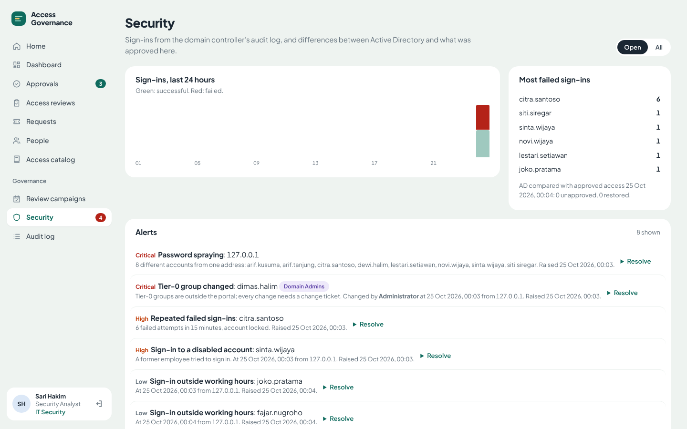

## Diuji end-to-end

`tests/e2e.py` menjalankan 26 skenario lewat browser (Playwright) dan memverifikasi hasilnya **langsung ke Active Directory**, antara lain:

- permintaan privileged: manager menyetujui, akses belum ada di AD, IT Security menyetujui, akses muncul di AD;
- batas durasi dan pemisahan tugas ditegakkan;
- joiner lewat form HR menghasilkan akun dengan group sesuai jabatan; mover menukar akses; leaver menonaktifkan akun tanpa group;
- pencabutan di access review langsung menghapus akses di AD;
- alert akses di luar portal ditindaklanjuti dan aksesnya hilang dari AD;
- karyawan tidak bisa membuka halaman orang lain, halaman admin, atau dashboard; form tanpa CSRF token ditolak;
- dashboard tampil lengkap dengan grafiknya, dan dashboard manager hanya berisi timnya.

Hasil terakhir: **26/26 lulus**.

---

## Menjalankan

Kebutuhan: Docker dan Docker Compose. Seluruh lab memakai memori sekitar 1–2 GB.

```bash
cp .env.example .env            # ganti password (AD, MySQL) dan IGA_SECRET_KEY
docker compose up -d --build
docker compose logs -f iga      # tunggu "[seed] Selesai" dan "Application startup complete"
```

Buka **http://localhost:8080** dan masuk dengan salah satu persona (password `Welc0me!Lab-2026`, atau nilai `IGA_INITIAL_PASSWORD` di `.env`):

| Akun | Peran | Coba ini |
|---|---|---|
| `joko.pratama` | Finance Staff | Minta akses **Server-Admins** selama 3 hari |
| `fajar.nugroho` | Finance Manager (atasan Joko) | Setujui permintaan Joko di **Approvals**, lalu kerjakan **Access reviews** |
| `sari.hakim` | Security Analyst | Buka **Dashboard**, setujui sebagai IT Security, buka **Security**, mulai **Review campaign** |
| `hana.wijaya` | HR Manager | **Add new joiner**, lalu pindahkan jabatannya dan proses keluarnya |

### Memicu skenario insiden

```bash
docker compose exec lab-activity python lab_activity.py --scenario
```

Simulator akan melakukan brute force, password spraying, percobaan login mantan karyawan, menambahkan user ke Server-Admins langsung di AD, dan menambahkan user ke Domain Admins. Alert muncul di halaman **Security** dalam 30 detik. Aktivitas login normal berjalan otomatis di jam kerja (07:00–21:00).

### Notifikasi Telegram

Isi `TELEGRAM_BOT_TOKEN` dan `TELEGRAM_CHAT_ID` di `.env`, lalu `docker compose up -d`. Alert critical dan high dikirim ke chat tersebut.

### Mengulang dari nol

```bash
docker compose down -v && docker compose up -d --build
```

| Layanan | Alamat |
|---|---|
| Portal IGA | http://localhost:8080 |
| Metrics Prometheus | http://localhost:8080/metrics |
| LDAPS (LDAP browser, uji e2e) | `localhost:6360` |
| MySQL (Workbench, Grafana) | `127.0.0.1:3307`, akun `iga_reader` |

Port dibuat berbeda dari dua lab saya yang lain ([MySQL monitoring](https://github.com/iamdhikka/mysql-observability-tuning) dan [AD access monitoring](https://github.com/iamdhikka/ad-access-monitoring)), sehingga semuanya bisa berjalan bersamaan.

## Menyesuaikan katalog akses

Semua jabatan, group, dan aturan ada di [`app/catalog.yaml`](app/catalog.yaml):

```yaml
groups:
  Server-Admins: {description: "Local admin on application servers", requestable: true, privileged: true, max_days: 7}
positions:
  fin-manager: {title: "Finance Manager", department: Finance, groups: [GRP-Finance, VPN-Users, APP-ERP-User, APP-ERP-Approver, SHARE-Finance]}
```

Group baru dibuat otomatis di `OU=Corp,OU=Groups` saat portal dijalankan.

## Menuju produksi

Yang perlu diubah sebelum dipakai di domain sungguhan:

- **Sumber data HR.** Lab memakai form HR di portal. Di perusahaan, data biasanya ditarik dari sistem HR (API atau ekspor terjadwal) supaya HR tidak menginput dua kali.
- **Database.** Jalankan MySQL dengan replikasi (atau managed service), backup terjadwal (`mysqldump`/XtraBackup), TLS antara portal dan database, dan password di vault. Akun `iga_app` sudah tanpa hak `DROP`/`GRANT`; di produksi, pembuatan tabel bisa dipisah ke akun migrasi sehingga `CREATE`/`ALTER` juga dicabut.
- **Akun layanan.** Gunakan gMSA atau simpan password di vault; batasi delegasi ke OU dan atribut yang benar-benar diperlukan, bukan full control seperti di lab.
- **Login.** Tambahkan SSO (SAML/OIDC) dan MFA di depan portal; pasang HTTPS lewat reverse proxy.
- **Audit log DC.** Di Windows Server, sumber yang setara adalah Security Event Log (4624, 4625, 4728/4732/4756) yang diteruskan lewat Windows Event Forwarding atau agen SIEM.
- **Matikan `lab-activity`** dan set `IGA_FORCE_PASSWORD_CHANGE=true` serta `IGA_SEED_DEMO=false`.

## Struktur repo

```
samba/        Domain controller: CA & sertifikat LDAPS, provisioning, audit log JSON, delegasi svc-iga
mysql/        MySQL 8.4: konfigurasi dan pembuatan akun iga_app / iga_reader
app/          Portal IGA
  catalog.yaml   jabatan, group, aturan durasi, Tier-0
  iga/jml.py     joiner, mover, leaver, entitlement, jabatan sementara
  iga/requests_flow.py  permintaan, approval berlapis, aktivasi & kedaluwarsa
  iga/certification.py  kampanye access review
  iga/security.py       ingest audit log, deteksi, rekonsiliasi AD vs portal
  iga/dashboard.py      angka & seri dashboard: SLA, waktu keputusan, tren, JML, alert
  iga/web.py            halaman, otorisasi per peran, CSRF, /metrics
  iga/db.py             skema MySQL dan akses database
  iga/seed.py           organisasi demo
tools/        Simulator aktivitas login dan skenario insiden (khusus lab)
tests/        Uji end-to-end lewat browser + verifikasi ke AD
docs/         Diagram topologi dan screenshot
```

## Galeri

| | |
|---|---|
| 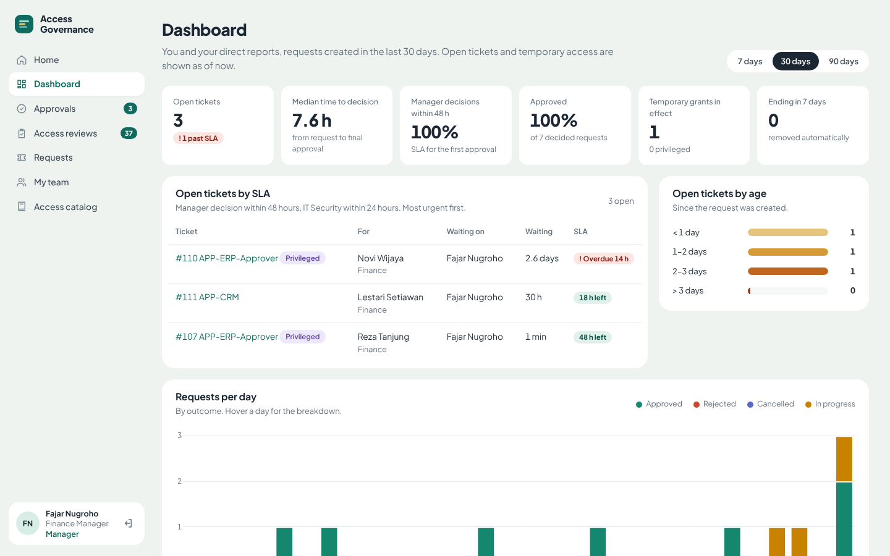 | 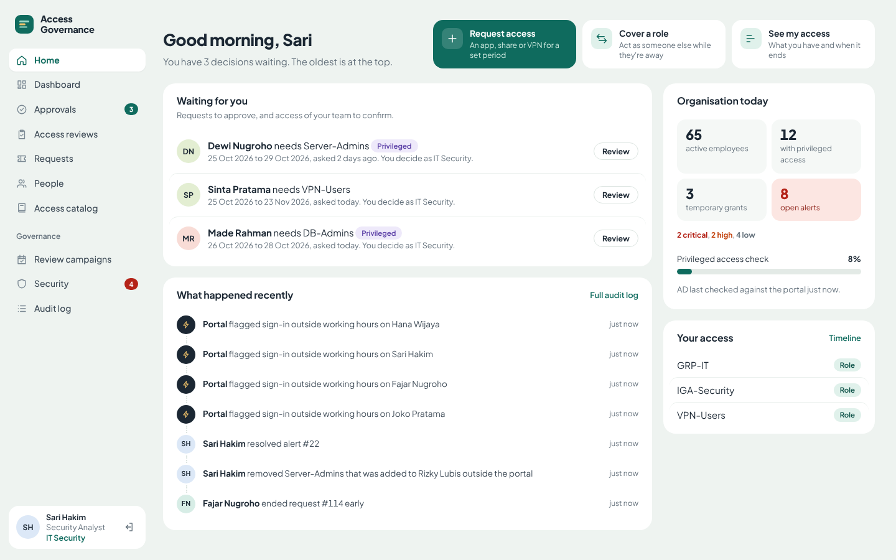 |
| 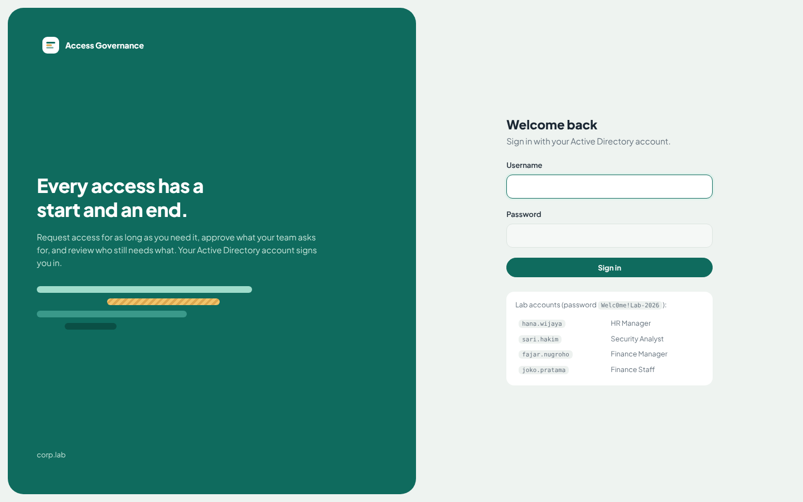 |  |
| 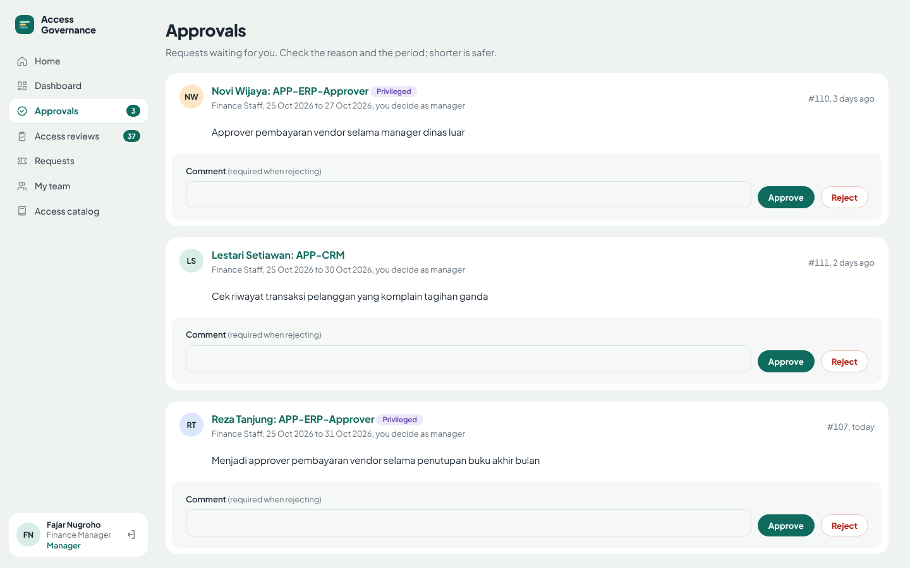 | 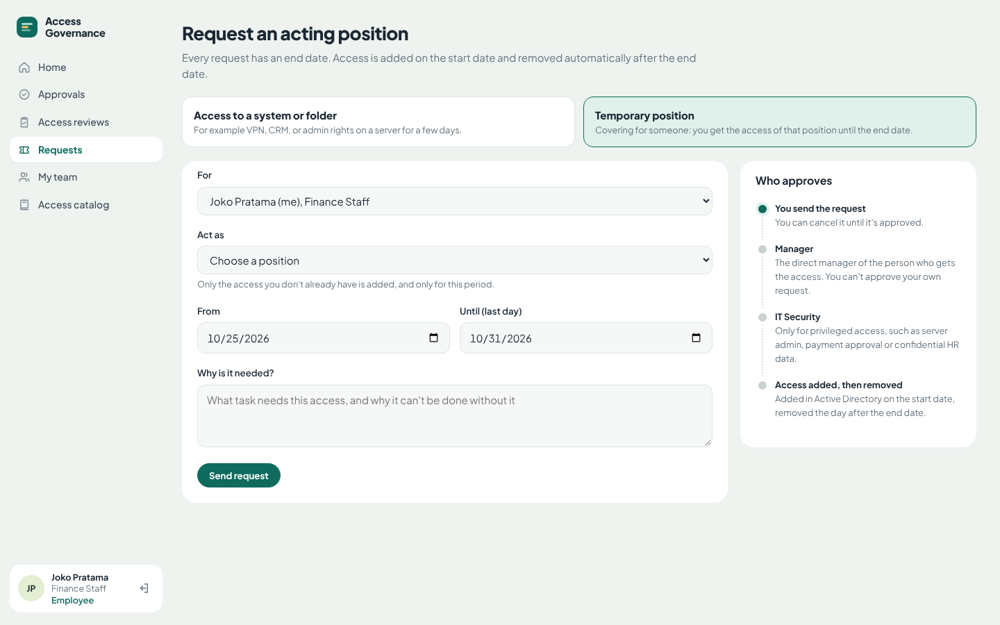 |
| 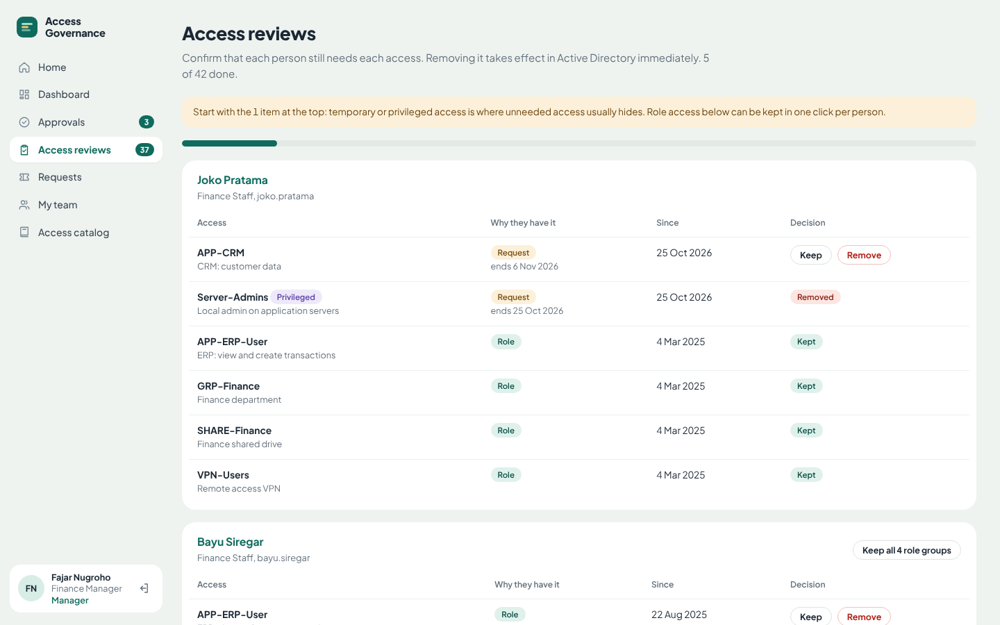 | 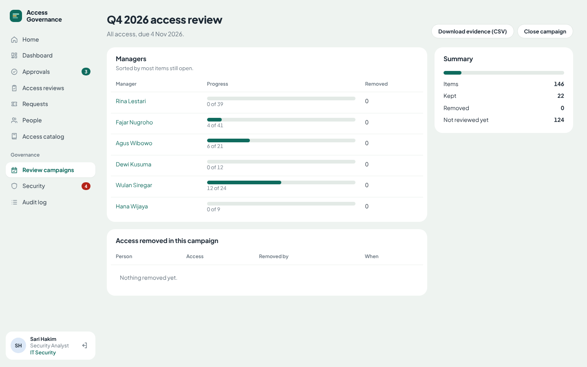 |
| 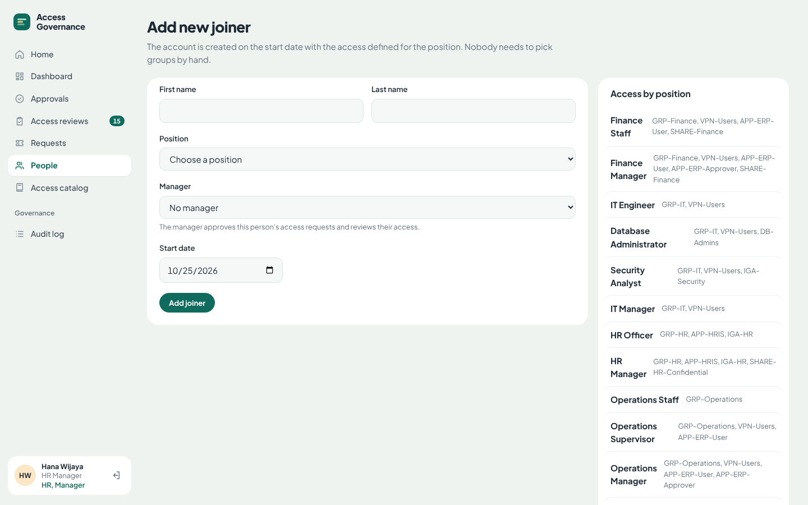 | 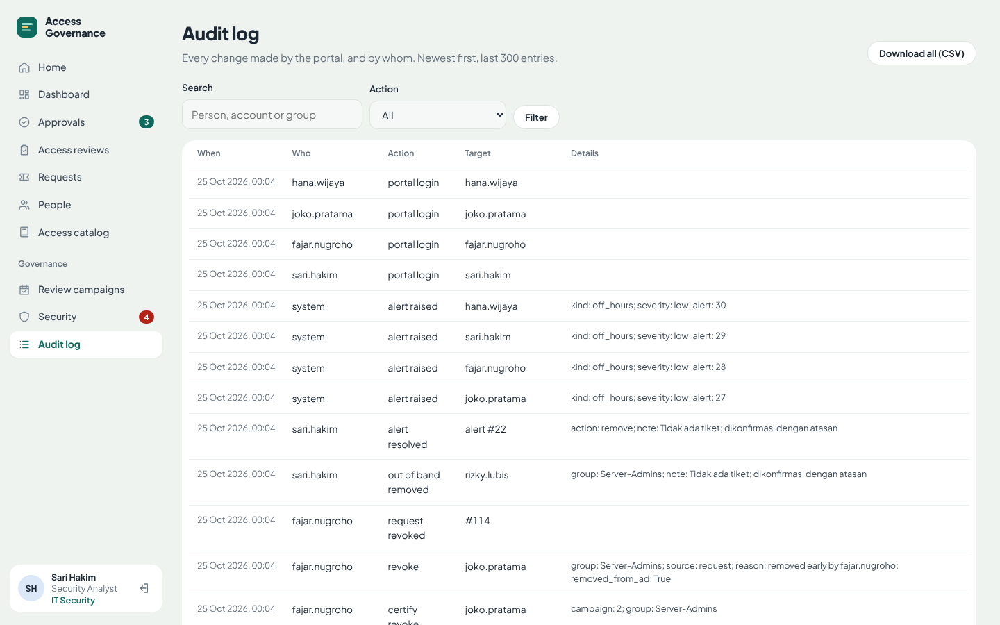 |

---

## Tentang

Dibuat oleh Andhika Suryamiharja. Saya bekerja di bidang IT Security (Access Management) dan membangun lab ini untuk menunjukkan cara mengotomasi siklus hidup identitas dan tata kelola akses di Active Directory. Hubungi saya lewat [LinkedIn](#) atau [email](#).
